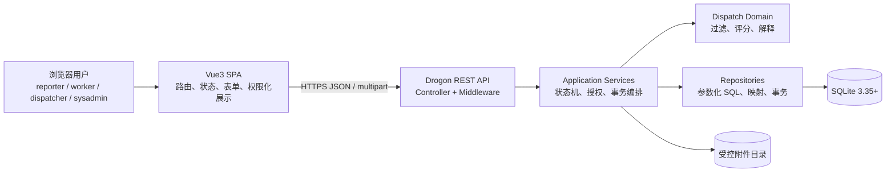

# CampusFix P0 系统架构基线

> **版本**：V1.0（W1-D5 P0 冻结基线）
> **技术路线**：C++17 + Drogon + Vue3 + Element Plus + Axios + ECharts + SQLite
> **性质**：软件设计文档，不表示工程、接口、迁移或测试已经实现。

## 1. 架构目标与边界

CampusFix 是前后端分离的校园维修工单系统。P0 必须保留四角色服务端鉴权、完整工单闭环、可解释智能调度、SQLite 事务一致性、附件授权访问和可执行测试。排班/提醒、动态权重、多策略、管理员无申请主动改派、复杂草稿体验、账户与权限管理后台均在 P1。

冻结的规模为 15 个 FR（13 个 P0、2 个 P1）、10 个工单状态、T-01～T-23 状态转换、E-01～E-02 过程事件、16 张 P0 表和 API-01～API-33。编号来源分别是 `requirements-trace.md`、`flows.md`、`database-design.md` 和 `api-contract.md`。

## 2. 系统上下文与组件



浏览器永远不直接访问数据库或真实附件路径。附件下载也先经 API 完成工单级鉴权。P0 不连接学校统一认证、短信、邮件、地图或外部 AI 服务。

## 3. 后端分层职责与依赖方向

| 层 | 职责 | 禁止事项 |
|---|---|---|
| Middleware | request_id、认证会话、统一错误入口、基础限流钩子 | 不执行业务状态跳转 |
| Controller | 解析路径/JSON/multipart、调用 Service、映射 HTTP/DTO | 不拼 SQL、不自行授权、不决定目标状态 |
| Service | 动作权限与数据范围、状态机、字段校验、事务边界、日志与响应白名单 | 不信任前端身份/状态/得分 |
| Domain | 状态转换规则、调度硬过滤与纯评分、值对象 | 不读写数据库、不依赖 Drogon HTTP 类型 |
| Repository | 参数化查询、事务对象、SQLite 特有并发/索引适配、行映射 | 不承载跨模块业务决策 |
| Infrastructure | SQLite 连接、密码哈希、随机 Token、时间、文件存储、日志 | 不绕过 Service 直接改变业务状态 |

依赖方向固定为 Controller/Middleware → Service → Domain/Repository → Infrastructure。Domain 不反向依赖 Web 或持久化实现，以便调度算法和状态规则可单元测试并为未来数据库迁移保留边界。

## 4. 业务模块映射

| 模块 | FR | 主要 API | 主要表 | 主要页面 |
|---|---|---|---|---|
| Auth | FR-001/002 | 01～03 | users、auth_sessions、management_grants | Login、AppLayout |
| Catalog | FR-003/006 | 04～05 | locations、skills、fault_categories | ReportNew、管理筛选 |
| WorkOrder | FR-003～005/009/010 | 06～13、23～27、33 | work_orders、status_logs、evaluations | ReportNew、OrderDetail、AdminOrders、WorkerTasks |
| Worker | FR-006 | 14～16 | workers、worker_skills、assignments | WorkerProfile、AdminWorkers |
| Dispatch/Assignment | FR-007/008/013 | 17～22 | assignments、transfer_requests、dispatch_records | Dispatch、WorkerTasks、AdminOrders |
| File | FR-011 | 28～30 | attachments | ReportNew、OrderDetail、WorkerTasks |
| Statistics | FR-012 | 31～32 | 授权范围内只读聚合 | AdminDashboard |

## 5. 认证、授权与数据范围

1. Bearer Token 只在客户端持有明文，数据库只存哈希；退出和过期可撤销。
2. 每账户一个主要角色；worker 可按本人身份报修，但不会获得 reporter 对他人工单的权限。
3. dispatcher 的业务动作还需 `AREA_SCOPE` 覆盖目标位置。sysadmin 角色本身不提供业务通行权，须取得对应能力码，其能力记录的 `scope_location_id` 限定区域（NULL 才表示该能力全局）；`AREA_SCOPE` 本身不授予 sysadmin 动作。
4. sysadmin 永远不能冒充当前维修员完成接单/维修，也不能冒充原报修人验收/评价。
5. 鉴权顺序：认证 → 动作能力 → 资源范围 → 状态/字段前置 → 版本与并发 → 原子写入 → 受众 DTO 过滤。
6. 跨资源读取用 404 隐藏存在性；已明确可见资源但动作不允许时使用 403。

## 6. 状态机与事件所有权

工单 Service 是 T-01～T-23 的唯一写入口。Controller 不接受客户端目标状态；Repository 只执行 Service 已决定且带前置条件的写入。所有状态更新采用 `expected_version` 条件更新，失败返回 409 且不写日志。

E-01 `ARRIVED` 和 E-02 `PROGRESS_NOTE` 是关联当前派单的追加事件，不改变工单状态或版本。每个派单最多一个到场事件；过程事件只允许当前负责人在 `IN_PROGRESS` 创建。

## 7. 关键事务边界

| 操作 | 同一事务的原子集合 |
|---|---|
| 首次提交 | 验证草稿/版本 → 更新日期流水 → 生成唯一编号 → 工单进入待审核 → 日志 |
| 审核/退回/取消/关闭 | 条件更新主体与时间字段 → 追加日志 |
| 确认派单 | `BEGIN IMMEDIATE` → 重读范围/状态/人员/负载 → 重算排名 → 校验理由 → 派单 + 最终快照 + 工单 + 日志 |
| 接单 | 更新当前派单 accepted_at → 工单进入处理中 → 日志 |
| 拒单 | 结束派单 → 取代未决申请 → 工单回待派单 → 日志；结束即释放负载 |
| 转派审批 | 解决申请；批准时结束派单、释放负载并回待派单；拒绝时主体不变；均追加日志 |
| 到场/进度 | 重查当前派单、状态和版本 → 插入关联派单的事件日志 |
| 提交维修结果 | 更新 repair_summary/result_submitted_at → 未决申请 SUPERSEDED → 工单待验收 → 日志 |
| 验收 | 通过时工单完成 + 派单以 COMPLETED 结束/释放负载；失败时返工计数 + 回处理中；均追加日志 |
| 评价 | 校验本人/COMPLETED/版本 → 插入唯一评价 → 同状态日志 |

事务中不执行文件 I/O、HTTP 调用或耗时评分。API-17 在事务外使用一致的只读查询计算预览；API-18 在短写事务内重新计算最终结果，不能复用客户端或旧预览作为事实。

## 8. SQLite 交互规范

- 最低 SQLite 3.35；每个连接启用 `foreign_keys=ON`，配置合理 `busy_timeout`，开发/演示可启用 WAL。
- 所有 SQL 参数化；连接与事务由 Repository/UnitOfWork 封装，Service 决定提交或回滚。
- 普通状态竞争使用乐观锁；容量竞争与派单使用短 `BEGIN IMMEDIATE`，避免不同工单同时占用最后一个容量。
- 单工单唯一有效派单、唯一评价、唯一到场及唯一待处理转派申请由部分唯一索引作最终防线。
- 历史业务外键默认 `ON DELETE RESTRICT`；用户/基础数据停用而非删除。SQLite 专有表达集中在迁移和 Repository 层。

## 9. 调度模块

Dispatch Domain 先执行账户、可用性、技能/资质、区域、容量硬过滤，再以冻结权重计算 0～100 分。效率和评价的数据选择、冷启动阈值、最近 20 样本及舍入规则以 SRS 第 50 章为准。

API-17 返回 Top 3、其他合格人员、分项、样本量、理由和排除摘要，严格不写数据库。API-18 允许选择任何合格人员；非 Top 3 理由必填，并保存最终重算的权重、候选依据、选中人员与排名。管理员无维修员申请时主动改派不在 P0。

## 10. 附件一致性

上传先进入隔离临时文件，完成扩展名、真实 MIME、大小和内容校验；短事务内重查工单权限/状态以及对应 purpose 的剩余数量并写元数据；提交后原子移动到随机相对路径。移动失败须补偿元数据，数据库失败须删除临时文件。

`REPORT` 与 `REPAIR_RESULT` 分别最多 3 张、单张最多 5 MiB。下载由附件 ID 反查工单并鉴权，任何 DTO/日志不得暴露 `stored_path`。

## 11. 前端架构

- Vue Router：认证守卫、角色与 capability 元数据；仅作体验控制。
- Pinia：AuthStore 保存会话/本人授权，WorkOrderStore 缓存当前 DTO 与版本；409 后刷新而非猜测状态。
- Axios：统一 Authorization、request_id、401 退出和业务错误映射。
- 页面组件只调用 API client；复用 WorkOrderStatusTag、Timeline、SecureImage、ConfirmActionDialog、AsyncState 和 EmptyState。
- API DTO 使用受众白名单；前端不得依赖“隐藏字段”作为安全措施。

## 12. 错误、审计与可观测性

HTTP 状态与稳定业务码同时返回；所有响应带 `request_id`，服务日志不得记录密码、明文 Token、完整联系方式或附件字节。状态日志是面向业务的追加历史，运行日志是诊断证据，两者不可混用。事务失败必须回滚且不得伪造“已通过”测试状态。

## 13. W2 工程结构输入（仅设计，不创建）

```text
backend/
  CMakeLists.txt
  src/{controllers,middleware,services,domain,repositories,infrastructure,models,dto}
  tests/{unit,integration}
  migrations/
frontend/
  src/{api,router,stores,views,components,types,utils}
  tests/
data/{attachments,tmp}/
```

W2 首个垂直切片只应建立可编译工程、配置加载、SQLite 连接/迁移入口、统一响应与 `/health`，不得借环境初始化改变已冻结业务规则。实际目录以 W2 评审后的工程约定为准。

## 14. W2 前置条件与冻结状态

进入 W2 前仍需确认本机编译环境（MSVC/WSL）、Drogon/SQLite 依赖获取方式、Node 包管理器、是否启用 TypeScript/Vitest，以及课程/答辩硬性要求。上述环境选择不得改变 P0 业务基线；如造成范围影响，必须新增决策记录。

本架构与 W1-D5 配套文档已经形成设计基线，但业务代码、数据库迁移、依赖安装、编译和测试均尚未开始，也未宣称通过。
