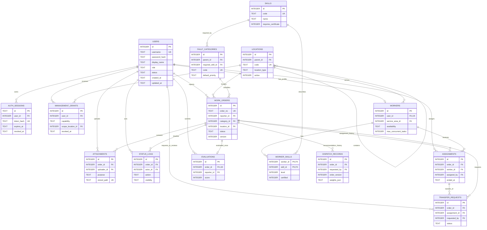

# CampusFix 数据库设计（W1-D4）

> **版本**：V0.1（W1-D4 设计稿，W1-D5 评审后冻结）
>
> **范围**：SQLite 上的 P0 数据模型；本文不包含正式迁移脚本，也不表示数据库已经创建。
> **依据**：`docs/SRS.md` 第 45～56 章、`docs/requirements-trace.md`、`docs/flows.md`、`docs/roles.md`。

## 1. 设计约定

- 表名、字段名使用复数蛇形命名；主键统一为 `INTEGER`，API 中按整数传递。
- 时间统一保存为 UTC ISO-8601 文本，例如 `2026-10-19T08:30:00.000Z`；展示时由前端转换时区。
- 布尔值使用 `INTEGER NOT NULL CHECK (value IN (0,1))`；JSON 快照使用 `TEXT`，由服务层校验结构。
- 业务枚举使用稳定英文码并加 `CHECK` 或服务层白名单。工单状态只能使用 W1-D3 的十个固定码。
- 所有数据库连接启用 `PRAGMA foreign_keys=ON`；建议 WAL 与合理 `busy_timeout`。事务保持短小，不在写事务中执行文件 I/O 或耗时评分计算。
- `users.role` 是 P0 唯一主要角色。`worker` 为本人报修不改变角色；`sysadmin` 的业务能力必须由 `management_grants` 明确授予。
- 工单、状态历史、派单历史、调度快照和评价不做物理删除。附件采用逻辑删除并由受控清理任务处理孤立文件。
- P1/P2 的排班、通知、动态权重、自动验收、复杂多角色和通用操作日志不进入本期表结构。

## 2. P0 表清单

| 表 | 主要职责 | 关联 FR |
|---|---|---|
| `users` | 账号、主角色与启停状态 | FR-001、FR-002 |
| `auth_sessions` | 可撤销会话 Token 的哈希与有效期 | FR-001 |
| `management_grants` | 管理能力及区域范围的显式授权 | FR-002 |
| `locations` | 校区、建筑、楼层、房间层级 | FR-002～FR-007 |
| `skills` | 技能及资质要求 | FR-006、FR-007 |
| `fault_categories` | 故障分类、默认优先级和所需技能 | FR-003、FR-005～FR-007 |
| `workers` | 维修档案、服务区域、在岗状态和容量 | FR-006～FR-008 |
| `worker_skills` | 维修员技能、熟练度与资质 | FR-006、FR-007 |
| `order_number_sequences` | 按业务日期安全生成工单流水号 | FR-003、FR-013 |
| `work_orders` | 工单主体、状态、版本和关键时间 | FR-003～FR-010、FR-013 |
| `attachments` | 报修/维修结果图片元数据 | FR-011 |
| `assignments` | 派单历史与当前有效负责人 | FR-008、FR-013 |
| `transfer_requests` | 转派申请及审批结果 | FR-008 |
| `status_logs` | 追加式状态与业务事件时间线 | FR-004、FR-005、FR-008～FR-010 |
| `dispatch_records` | 推荐输入版本、固定权重和结果快照 | FR-007 |
| `evaluations` | 单工单一次有效评价 | FR-010 |

`transfer_requests` 和 `order_number_sequences` 是实现既定流程与并发规则所必需的支撑表；不增加新的用户功能。

## 3. Mermaid ER 图



## 4. 字段字典

以下默认值是逻辑设计；迁移脚本生成时必须验证所用 SQLite 版本和 Drogon 驱动支持。

### 4.1 `users`

| 字段 | 类型 | NULL | 默认值 | 约束/说明 |
|---|---|---:|---|---|
| `id` | INTEGER | 否 | 自增 | PK |
| `username` | TEXT | 否 | 无 | UNIQUE；登录名规范化后保存，长度 3～64 |
| `password_hash` | TEXT | 否 | 无 | 仅保存成熟密码算法输出 |
| `display_name` | TEXT | 否 | 无 | 长度 1～80 |
| `role` | TEXT | 否 | 无 | CHECK：`reporter/worker/dispatcher/sysadmin` |
| `status` | TEXT | 否 | `ACTIVE` | CHECK：`ACTIVE/DISABLED` |
| `created_at` | TEXT | 否 | 当前 UTC | |
| `updated_at` | TEXT | 否 | 当前 UTC | 应用层更新 |
| `last_login_at` | TEXT | 是 | NULL | 成功登录时更新 |

索引：`UNIQUE(username)`；`INDEX(status, role)`。

### 4.2 `auth_sessions`

| 字段 | 类型 | NULL | 默认值 | 约束/说明 |
|---|---|---:|---|---|
| `id` | TEXT | 否 | UUID | PK；公开会话标识，不是 Token |
| `user_id` | INTEGER | 否 | 无 | FK → `users.id` |
| `token_hash` | TEXT | 否 | 无 | UNIQUE；不保存完整明文 Token |
| `expires_at` | TEXT | 否 | 无 | 到期后无效 |
| `revoked_at` | TEXT | 是 | NULL | 退出时写入 |
| `created_at` | TEXT | 否 | 当前 UTC | |
| `last_seen_at` | TEXT | 是 | NULL | 可限频更新，避免每请求写库 |

索引：`UNIQUE(token_hash)`；`INDEX(user_id, revoked_at, expires_at)`。

### 4.3 `management_grants`

| 字段 | 类型 | NULL | 默认值 | 约束/说明 |
|---|---|---:|---|---|
| `id` | INTEGER | 否 | 自增 | PK |
| `user_id` | INTEGER | 否 | 无 | FK → `users.id`；主要服务于 `sysadmin` 显式业务授权 |
| `capability` | TEXT | 否 | 无 | `AREA_SCOPE/BUSINESS_READ/REVIEW/DISPATCH/CANCEL/CLOSE/WORKER_MANAGE/STATS_VIEW/INTERNAL_NOTE_READ/SYSTEM_MANAGE` |
| `scope_location_id` | INTEGER | 是 | NULL | FK → `locations.id`；NULL 表示该能力的全局范围，不表示拥有其他能力 |
| `granted_by` | INTEGER | 否 | 无 | FK → `users.id` |
| `granted_at` | TEXT | 否 | 当前 UTC | |
| `revoked_at` | TEXT | 是 | NULL | 非 NULL 后失效 |

部分唯一索引：对未撤销记录 `(user_id, capability, COALESCE(scope_location_id, 0))` 唯一。实现时如表达式部分索引兼容性不足，增加规范化的 `scope_key` 字段。索引：`INDEX(user_id, revoked_at)`、`INDEX(scope_location_id, capability)`。

`dispatcher` 按角色拥有管理动作，使用 `AREA_SCOPE` 记录管辖区域；角色权限与区域范围必须同时满足，区域内可读取内部管理信息。`sysadmin` 不使用 `AREA_SCOPE` 推导业务动作，而是必须取得对应 capability（包括读取内部备注）及其范围。没有有效范围记录时不得默认全局。

### 4.4 `locations`

| 字段 | 类型 | NULL | 默认值 | 约束/说明 |
|---|---|---:|---|---|
| `id` | INTEGER | 否 | 自增 | PK |
| `parent_id` | INTEGER | 是 | NULL | 自引用 FK；根校区为 NULL |
| `code` | TEXT | 否 | 无 | UNIQUE；稳定位置码 |
| `name` | TEXT | 否 | 无 | |
| `location_type` | TEXT | 否 | 无 | `CAMPUS/BUILDING/FLOOR/ROOM/AREA` |
| `active` | INTEGER | 否 | `1` | 布尔 CHECK；被引用后只能停用 |
| `created_at` | TEXT | 否 | 当前 UTC | |
| `updated_at` | TEXT | 否 | 当前 UTC | |

索引：`UNIQUE(code)`；`INDEX(parent_id, active)`。

### 4.5 `skills`

| 字段 | 类型 | NULL | 默认值 | 约束/说明 |
|---|---|---:|---|---|
| `id` | INTEGER | 否 | 自增 | PK |
| `code` | TEXT | 否 | 无 | UNIQUE |
| `name` | TEXT | 否 | 无 | |
| `requires_certificate` | INTEGER | 否 | `0` | 布尔 CHECK |
| `active` | INTEGER | 否 | `1` | 布尔 CHECK |
| `created_at` | TEXT | 否 | 当前 UTC | |
| `updated_at` | TEXT | 否 | 当前 UTC | |

索引：`UNIQUE(code)`；`INDEX(active)`。

### 4.6 `fault_categories`

| 字段 | 类型 | NULL | 默认值 | 约束/说明 |
|---|---|---:|---|---|
| `id` | INTEGER | 否 | 自增 | PK |
| `parent_id` | INTEGER | 是 | NULL | 自引用 FK |
| `code` | TEXT | 否 | 无 | UNIQUE |
| `name` | TEXT | 否 | 无 | |
| `required_skill_id` | INTEGER | 否 | 无 | FK → `skills.id` |
| `default_priority` | TEXT | 否 | `NORMAL` | `LOW/NORMAL/HIGH/URGENT` |
| `requires_certificate` | INTEGER | 否 | `0` | 类别可进一步要求资质 |
| `active` | INTEGER | 否 | `1` | 布尔 CHECK |
| `created_at` | TEXT | 否 | 当前 UTC | |
| `updated_at` | TEXT | 否 | 当前 UTC | |

索引：`UNIQUE(code)`；`INDEX(parent_id, active)`；`INDEX(required_skill_id)`。

### 4.7 `workers`

| 字段 | 类型 | NULL | 默认值 | 约束/说明 |
|---|---|---:|---|---|
| `id` | INTEGER | 否 | 自增 | PK |
| `user_id` | INTEGER | 否 | 无 | FK → `users.id`，UNIQUE；对应用户角色必须为 `worker` |
| `worker_no` | TEXT | 否 | 无 | UNIQUE |
| `team_name` | TEXT | 是 | NULL | |
| `service_area_id` | INTEGER | 否 | 无 | FK → `locations.id`；P0 主服务区域 |
| `work_phone` | TEXT | 是 | NULL | 仅授权管理人员按需返回 |
| `availability` | TEXT | 否 | `AVAILABLE` | `AVAILABLE/BUSY/OFF_DUTY/DISABLED`；P0 不建排班 |
| `max_concurrent_tasks` | INTEGER | 否 | `1` | CHECK `> 0` |
| `emergency_duty` | INTEGER | 否 | `0` | 布尔 CHECK；固定评分输入，不等同排班表 |
| `active` | INTEGER | 否 | `1` | 布尔 CHECK |
| `created_at` | TEXT | 否 | 当前 UTC | |
| `updated_at` | TEXT | 否 | 当前 UTC | |

索引：`UNIQUE(user_id)`、`UNIQUE(worker_no)`；`INDEX(service_area_id, availability, active)`。当前任务量不冗余保存，以 `assignments.ended_at IS NULL` 实时聚合。

### 4.8 `worker_skills`

| 字段 | 类型 | NULL | 默认值 | 约束/说明 |
|---|---|---:|---|---|
| `worker_id` | INTEGER | 否 | 无 | 复合 PK；FK → `workers.id` |
| `skill_id` | INTEGER | 否 | 无 | 复合 PK；FK → `skills.id` |
| `level` | INTEGER | 否 | 无 | CHECK 1～5 |
| `certified` | INTEGER | 否 | `0` | 布尔 CHECK |
| `active` | INTEGER | 否 | `1` | 布尔 CHECK |
| `effective_at` | TEXT | 否 | 当前 UTC | |
| `updated_at` | TEXT | 否 | 当前 UTC | |

主键：`(worker_id, skill_id)`；索引：`INDEX(skill_id, active, certified)`。

### 4.9 `order_number_sequences`

| 字段 | 类型 | NULL | 默认值 | 约束/说明 |
|---|---|---:|---|---|
| `business_date` | TEXT | 否 | 无 | PK，格式 `YYYYMMDD`，按业务时区计算 |
| `last_value` | INTEGER | 否 | `0` | CHECK 0～9999 |
| `updated_at` | TEXT | 否 | 当前 UTC | |

该表只负责流水分配，不对外提供 CRUD。

### 4.10 `work_orders`

| 字段 | 类型 | NULL | 默认值 | 约束/说明 |
|---|---|---:|---|---|
| `id` | INTEGER | 否 | 自增 | PK |
| `order_no` | TEXT | 是 | NULL | UNIQUE；正式提交时生成 `WXYYYYMMDDNNNN`，草稿可暂为空 |
| `reporter_id` | INTEGER | 否 | 无 | FK → `users.id`；仅由认证身份决定 |
| `category_id` | INTEGER | 否 | 无 | FK → `fault_categories.id` |
| `location_id` | INTEGER | 否 | 无 | FK → `locations.id` |
| `title` | TEXT | 否 | 无 | 1～120 字符 |
| `description` | TEXT | 否 | 无 | 1～2000 字符 |
| `requested_urgency` | TEXT | 否 | `NORMAL` | `LOW/NORMAL/HIGH/URGENT` |
| `approved_urgency` | TEXT | 是 | NULL | 审核通过时确认，同上枚举 |
| `expected_visit_at` | TEXT | 是 | NULL | 可选 UTC 时间 |
| `contact_name` | TEXT | 否 | 无 | 仅最小必要受众可见 |
| `contact_phone` | TEXT | 否 | 无 | 格式由 API 校验；不进入普通列表 |
| `status` | TEXT | 否 | `DRAFT` | 十个固定状态码 CHECK |
| `version` | INTEGER | 否 | `1` | 每次受保护写操作 `+1` |
| `repair_summary` | TEXT | 是 | NULL | 最近一次提交结果；历史以日志保留 |
| `rework_count` | INTEGER | 否 | `0` | CHECK `>=0` |
| `created_at` | TEXT | 否 | 当前 UTC | |
| `updated_at` | TEXT | 否 | 当前 UTC | |
| `submitted_at` | TEXT | 是 | NULL | 首次正式提交时间 |
| `completed_at` | TEXT | 是 | NULL | 验收通过时间 |
| `closed_at` | TEXT | 是 | NULL | 归档时间 |
| `cancelled_at` | TEXT | 是 | NULL | 取消/审核拒绝时间 |

约束与索引：`UNIQUE(order_no)`（SQLite 允许多个 NULL）；`INDEX(reporter_id, created_at DESC)`；`INDEX(status, updated_at DESC)`；`INDEX(category_id, status)`；`INDEX(location_id, status)`。终态主体不可通过普通更新修改，由 Service 保证并用集成测试验证。

### 4.11 `attachments`

| 字段 | 类型 | NULL | 默认值 | 约束/说明 |
|---|---|---:|---|---|
| `id` | INTEGER | 否 | 自增 | PK |
| `order_id` | INTEGER | 否 | 无 | FK → `work_orders.id` |
| `uploader_id` | INTEGER | 否 | 无 | FK → `users.id` |
| `purpose` | TEXT | 否 | 无 | `REPORT/REPAIR_RESULT` |
| `original_name` | TEXT | 否 | 无 | 仅文件名，不含客户端路径 |
| `stored_path` | TEXT | 否 | 无 | UNIQUE；随机/哈希相对路径，禁止用户控制 |
| `mime` | TEXT | 否 | 无 | `image/jpeg/image/png/image/webp` |
| `size_bytes` | INTEGER | 否 | 无 | CHECK `1..5242880` |
| `sha256` | TEXT | 否 | 无 | 文件完整性与清理辅助，不作为公开下载凭证 |
| `created_at` | TEXT | 否 | 当前 UTC | |
| `deleted_at` | TEXT | 是 | NULL | 逻辑删除 |

索引：`UNIQUE(stored_path)`；`INDEX(order_id, purpose, deleted_at)`。每工单最多 3 张有效图片由上传事务内计数并再次校验；不依赖前端计数。

### 4.12 `assignments`

| 字段 | 类型 | NULL | 默认值 | 约束/说明 |
|---|---|---:|---|---|
| `id` | INTEGER | 否 | 自增 | PK |
| `order_id` | INTEGER | 否 | 无 | FK → `work_orders.id` |
| `worker_id` | INTEGER | 否 | 无 | FK → `workers.id` |
| `assigned_by` | INTEGER | 否 | 无 | FK → `users.id` |
| `assign_reason` | TEXT | 是 | NULL | 手工调整/改派时必填；推荐首选可选 |
| `assigned_at` | TEXT | 否 | 当前 UTC | |
| `accepted_at` | TEXT | 是 | NULL | 接单时间 |
| `ended_at` | TEXT | 是 | NULL | NULL 表示当前有效派单 |
| `end_reason` | TEXT | 是 | NULL | `REFUSED/TRANSFERRED/COMPLETED/CANCELLED` 或说明 |
| `version` | INTEGER | 否 | `1` | 派单记录乐观锁 |

关键约束：`CREATE UNIQUE INDEX ... ON assignments(order_id) WHERE ended_at IS NULL`，从数据库层保证单工单最多一个有效派单。索引：`INDEX(worker_id, ended_at)` 用于实时负载；`INDEX(order_id, assigned_at)` 用于历史。

### 4.13 `transfer_requests`

| 字段 | 类型 | NULL | 默认值 | 约束/说明 |
|---|---|---:|---|---|
| `id` | INTEGER | 否 | 自增 | PK |
| `order_id` | INTEGER | 否 | 无 | FK → `work_orders.id` |
| `assignment_id` | INTEGER | 否 | 无 | FK → `assignments.id`；必须是申请时有效派单 |
| `requested_by` | INTEGER | 否 | 无 | FK → `users.id`；必须是当前负责人账号 |
| `reason` | TEXT | 否 | 无 | 1～500 字符 |
| `status` | TEXT | 否 | `PENDING` | `PENDING/APPROVED/REJECTED/SUPERSEDED`；任务进入不再可转派的阶段时失效 |
| `reviewed_by` | INTEGER | 是 | NULL | FK → `users.id` |
| `review_reason` | TEXT | 是 | NULL | 审批说明；拒绝时必填 |
| `created_at` | TEXT | 否 | 当前 UTC | |
| `reviewed_at` | TEXT | 是 | NULL | |
| `order_version` | INTEGER | 否 | 无 | 申请时工单版本快照 |

部分唯一索引：`UNIQUE(assignment_id) WHERE status='PENDING'`，重复待处理申请返回 409。索引：`INDEX(order_id, status)`。

### 4.14 `status_logs`

| 字段 | 类型 | NULL | 默认值 | 约束/说明 |
|---|---|---:|---|---|
| `id` | INTEGER | 否 | 自增 | PK |
| `order_id` | INTEGER | 否 | 无 | FK → `work_orders.id` |
| `actor_id` | INTEGER | 是 | NULL | FK → `users.id`；系统事件可为 NULL，P0 无自动验收 |
| `action` | TEXT | 否 | 无 | 稳定动作码，如 `ORDER_SUBMITTED` |
| `from_status` | TEXT | 是 | NULL | 创建事件为 NULL，其余用固定状态码 |
| `to_status` | TEXT | 否 | 无 | 固定状态码；只读事件可与前状态相同 |
| `public_note` | TEXT | 是 | NULL | 可返回给报修人/维修员的必要说明 |
| `internal_note` | TEXT | 是 | NULL | 只对有 `INTERNAL_NOTE_READ` 的授权管理人员返回 |
| `metadata_json` | TEXT | 是 | NULL | 字段变更摘要/关联 ID；不得放密码、Token、完整敏感信息 |
| `created_at` | TEXT | 否 | 当前 UTC | |
| `request_id` | TEXT | 否 | 无 | 关联服务日志与幂等排查 |

索引：`INDEX(order_id, created_at, id)`；`INDEX(actor_id, created_at)`。该表只允许插入和查询，普通业务接口不得更新或删除。

### 4.15 `dispatch_records`

| 字段 | 类型 | NULL | 默认值 | 约束/说明 |
|---|---|---:|---|---|
| `id` | INTEGER | 否 | 自增 | PK |
| `order_id` | INTEGER | 否 | 无 | FK → `work_orders.id` |
| `requested_by` | INTEGER | 否 | 无 | FK → `users.id` |
| `order_version` | INTEGER | 否 | 无 | 计算时版本，仅作快照，不能直接用于派单 |
| `strategy` | TEXT | 否 | `WEIGHTED_SCORE_V1` | P0 固定策略 |
| `weights_json` | TEXT | 否 | 固定六项权重快照 |
| `candidates_json` | TEXT | 否 | top 3、分项分数、理由、风险及样本标记 |
| `excluded_summary_json` | TEXT | 否 | 按硬约束原因聚合 |
| `created_at` | TEXT | 否 | 当前 UTC | |

索引：`INDEX(order_id, created_at DESC)`。推荐不改变工单、派单或负载；是否记录推荐快照是唯一允许的写入。

### 4.16 `evaluations`

| 字段 | 类型 | NULL | 默认值 | 约束/说明 |
|---|---|---:|---|---|
| `id` | INTEGER | 否 | 自增 | PK |
| `order_id` | INTEGER | 否 | 无 | FK → `work_orders.id`，UNIQUE |
| `reporter_id` | INTEGER | 否 | 无 | FK → `users.id`；必须等于工单原报修人 |
| `score` | INTEGER | 否 | 无 | CHECK 1～5 |
| `comment` | TEXT | 是 | NULL | 最多 1000 字符 |
| `created_at` | TEXT | 否 | 当前 UTC | |

约束：`UNIQUE(order_id)`；索引：`INDEX(reporter_id, created_at)`。评价只允许在 `COMPLETED` 创建；不改变工单状态，`CLOSED` 后拒绝新增。

## 5. 关系、访问范围与响应数据

- 报修权限：`work_orders.reporter_id = authenticated_user.id`；`worker` 本人报修沿用同一规则。
- 维修权限：当前有效负责人由 `assignments.order_id = ? AND ended_at IS NULL` 唯一确定；历史负责人只有受控只读访问。
- 管理权限：`dispatcher` 角色动作许可 + 有效 `AREA_SCOPE` 覆盖工单位置；`sysadmin` 必须具有对应业务 `capability` 及其范围。位置覆盖包含授权节点的后代，查询实现应避免客户端自报范围。
- 附件继承工单访问权限；下载前先查询 `attachments.order_id` 并执行工单鉴权，绝不把 `stored_path` 暴露给客户端。
- 普通详情/时间线只能返回 `status_logs.public_note`；`internal_note`、调度权重、排除明细、管理原因仅返回给区域内 dispatcher，或具备 `INTERNAL_NOTE_READ` 明确授权及范围的 sysadmin。
- `password_hash`、`token_hash`、`stored_path` 永不进入 API 响应。联系电话只返回给原报修人、当前负责人及有最小必要权限的管理人员。

## 6. 并发安全与事务方案

### 6.1 工单编号

正式提交草稿时在短写事务中：

1. `BEGIN IMMEDIATE`，重新读取工单并验证 `status/version/reporter_id`。
2. 按业务时区得到 `YYYYMMDD`，原子插入或递增 `order_number_sequences.last_value`；禁止 `MAX(order_no)+1`。
3. 格式化 `WXYYYYMMDDNNNN`，写入 `work_orders.order_no`；唯一索引作为最终防线。
4. 条件更新工单为 `PENDING_REVIEW`、`version=version+1`，插入 `status_logs`。
5. 提交；遇数据库繁忙或唯一冲突仅在有限次数内重试，最终返回明确冲突/服务繁忙错误。

每日超过 9999 单时拒绝并记录运维错误，不扩展编号格式；格式变更需 W1-D5 后另立决策。

### 6.2 乐观锁

所有状态操作请求携带 `expected_version`。更新形如：

```text
UPDATE work_orders
SET status = :next_status, version = version + 1, updated_at = :now
WHERE id = :id AND status = :expected_status AND version = :expected_version;
```

受影响行数为 0 时回滚并返回 `409 ORDER_STATUS_CONFLICT` 或 `409 ORDER_VERSION_CONFLICT`，不写重复日志。只读推荐返回计算时的 `order_version`，派单仍须在事务内重新校验。

### 6.3 派单与负载

派单事务必须依次完成：重新校验管理范围、工单状态/版本、人员状态、技能/资质、区域；通过 `assignments WHERE worker_id=? AND ended_at IS NULL` 实时统计负载；插入新派单；条件更新工单；插入状态日志。部分唯一索引保证并发请求不产生两个有效负责人。任一步失败全部回滚。

拒单或批准转派事务必须结束当前 `assignments`、更新工单、完成转派申请（如有）并写日志。负载是查询结果，不维护独立计数，因此结束派单即释放负载。

### 6.4 其他关键事务

| 操作 | 同一事务内必须完成 |
|---|---|
| 审核/退回/拒绝/取消/关闭 | 条件更新工单、关键时间字段、追加状态日志 |
| 接单 | 条件更新派单 `accepted_at/version`、工单状态/version、状态日志 |
| 维修完成 | 保存最新 `repair_summary`、工单状态/version、状态日志；把该有效派单尚未处理的转派申请标记为 `SUPERSEDED`；附件已提前安全上传并关联 |
| 验收通过/不通过 | 通过时工单进入 `COMPLETED` 并结束有效派单（`end_reason=COMPLETED`）以释放负载；不通过时回 `IN_PROGRESS`、`rework_count+1` 并保留有效派单；两者均保留旧结果并追加日志 |
| 评价 | 校验身份和 `COMPLETED`、插入唯一评价、追加不改状态的评价事件；重复评价整体回滚 |
| 附件上传 | 临时文件校验后，在短事务内重查工单权限与有效数量并插入元数据；提交后原子移动文件，失败需补偿删除元数据/临时文件 |

## 7. 历史、删除与一致性要求

- `status_logs`、`assignments`、`transfer_requests`、`dispatch_records` 和 `evaluations` 是历史证据，不允许普通 CRUD 覆盖。
- 工单终态不物理删除。基础数据被引用后只能置 `active=0`；历史通过 ID 关联，必要名称快照放入日志 `metadata_json`，避免重命名使展示失真。
- `repair_summary` 是当前结果摘要；每次提交、返工原因及先前摘要必须写入追加日志，不能只覆盖主体字段。
- 数据库事务只保证元数据；附件文件系统操作采用临时文件、原子重命名和失败补偿，定期只读扫描孤立文件。
- 统计只读取授权范围内数据；完成率等口径必须与 API 文档一致，不把前端缓存当作事实来源。
- 备份、恢复和迁移必须同时覆盖 SQLite 文件与附件目录；复制 SQLite 前使用安全备份机制，不直接复制活跃 WAL 数据文件组合。

## 8. 迁移能力边界

- Repository 不暴露 SQLite 专有 SQL 给 Service；部分唯一索引、UPSERT 和日期流水实现集中在迁移/Repository 层。
- 不依赖 SQLite 动态类型做隐式转换；应用层绑定明确类型并对枚举、JSON、时间做验证。
- 不使用数据库生成的业务语义状态跳转；状态机仍由 Service 控制，数据库负责外键、唯一性、范围和基本 CHECK 防线。
- 后续迁移 MySQL/PostgreSQL 时需替换日期流水锁策略、部分唯一索引表达方式和 JSON 类型，但 API 字段与业务规则保持不变。

## 9. W1-D5 待确认/同步

1. 将 W1-D3 的 `sysadmin` 显式授权、worker 本人报修、内部备注可见性同步到 SRS、决策日志和需求追踪矩阵。
2. 冻结 `management_grants` 的能力码、区域继承规则及授权数据由 seed/运维还是后续管理 API 维护；复杂授权后台仍为 P1。
3. 冻结草稿阶段是否生成工单号。本稿选择“正式提交时生成”，避免未提交草稿消耗可展示流水。
4. 确认 P0 评价是否只保留单一 `score`。SRS 通用章节列出多维评分，但 V1.1 最小接口与追踪矩阵只要求 1～5 总分；本稿不自行扩大字段。
5. 确认管理员人工选择非 top 3 合格维修员时 `assign_reason` 是否始终必填；本稿规定偏离推荐时必填，仍不得突破硬约束。
6. 把“验收通过时结束有效派单并释放负载”以及“提交维修结果后待处理转派申请变为 `SUPERSEDED`”同步到流程说明；这是为消除悬挂负载/申请而作的 W1-D4 一致性细化。
