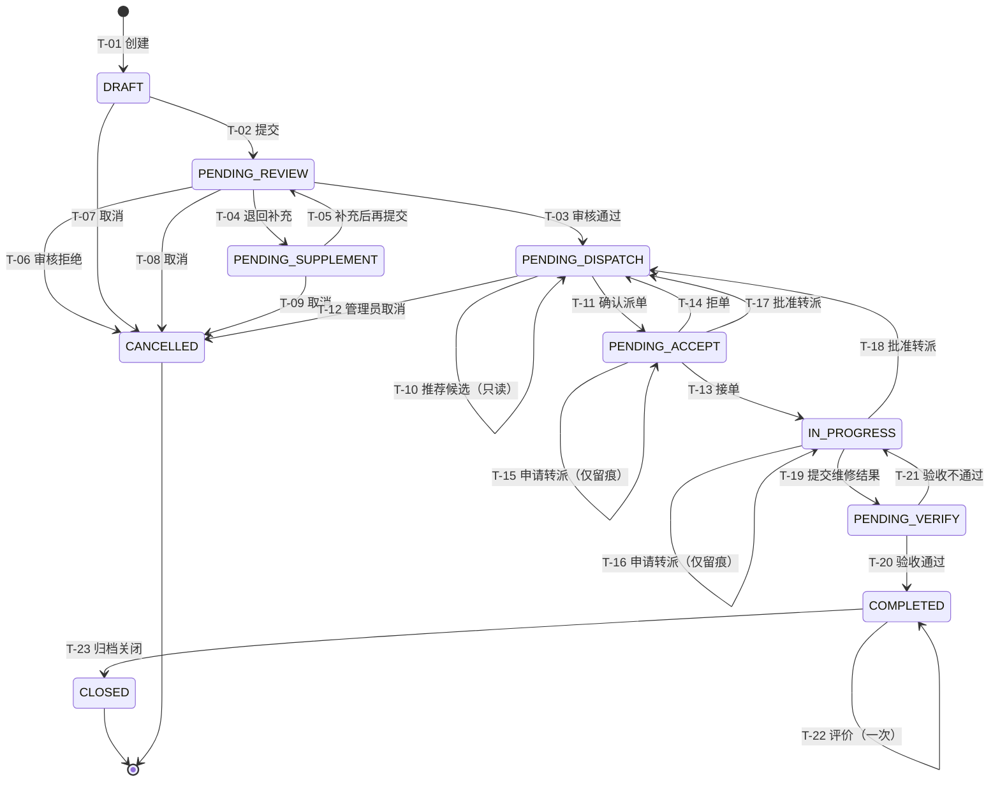

# CampusFix 工单状态机与业务流程（W1-D3）

> **版本**：V0.2（W1-D3 设计稿，W1-D5 评审后冻结）
> **依据**：`docs/SRS.md` 第 45～56 章、`docs/requirements-trace.md` 的 FR-003、FR-005、FR-007～FR-010、FR-013。
> **范围**：本文定义业务语义、状态转换、权限边界和预期测试，不代表接口或数据库已经实现。

## 1. 状态与共同规则

固定状态码如下，前端只映射中文文案，不得另造状态：

| 状态码 | 含义 | 是否终态 |
|---|---|---|
| `DRAFT` | 草稿 | 否 |
| `PENDING_REVIEW` | 待审核 | 否 |
| `PENDING_SUPPLEMENT` | 待补充 | 否 |
| `PENDING_DISPATCH` | 待派单 | 否 |
| `PENDING_ACCEPT` | 待接单 | 否 |
| `IN_PROGRESS` | 处理中 | 否 |
| `PENDING_VERIFY` | 待验收 | 否 |
| `COMPLETED` | 已完成，可评价/待归档 | 否 |
| `CLOSED` | 已关闭 | 是 |
| `CANCELLED` | 已取消 | 是 |

- 服务器根据当前身份、角色、资源范围、当前状态和 `version` 判断动作是否合法；客户端不能直接指定目标状态或操作者。
- P0 保留后端 `DRAFT` 与显式提交，不提供复杂草稿保存、恢复和编辑 UI；每个账户只有一个主要角色，`worker` 可为本人创建报修。
- `CLOSED`、`CANCELLED` 在 P0 中不可由普通业务操作恢复，也不可修改工单主体数据；授权用户仍可只读查看允许公开的历史。
- `COMPLETED` 可不经评价直接关闭；评价不改变状态，进入 `CLOSED` 后不再接受新评价。
- “已到场”“维修进度”“转派申请中”属于时间线事件，不新增工单状态。
- 智能推荐是只读计算；无候选时工单仍为 `PENDING_DISPATCH`，不得降低技能、资质、在岗、区域或容量硬约束。
- 状态日志只追加，不覆盖历史。涉及状态、有效派单、负载与日志的关键写入必须在同一事务中完成。

## 2. Mermaid 状态图

图中的 T 编号与第 3 节转换表一致；`[*]` 仅表示生命周期入口/终点，不是业务动作。

## 3. 全量状态转换表

表中“报修人”均指原报修人，“维修员”均指当前有效负责人；管理员操作还必须处于其管辖区域。`sysadmin` 不因角色天然获得下表中的调度业务权限，只有被明确授予对应业务权限时才能执行管理员动作，且仍受相同范围、状态和审计约束。错误码仅表达 W1-D3 预期语义，具体业务码和端点由 W1-D4 固定。

| 编号 | 当前状态 | 动作 | 允许角色 / 数据范围 | 目标状态 | 核心校验与同事务写入 | 审计数据 | 失败预期 |
|---|---|---|---|---|---|---|---|
| T-01 | 无 | 创建工单 | `reporter` 或 `worker` 为本人创建；P0 不支持管理员代报 | `DRAFT` | 分类、位置等引用有效；服务端确定 `reporter_id` | 创建人、时间、初始字段 | 参数无效 400/422；不得伪造报修人 |
| T-02 | `DRAFT` | 正式提交 | 原报修人 | `PENDING_REVIEW` | 必填字段完整、单号唯一、版本匹配 | 操作人、提交时间、状态日志 | 非本人 403/404；重复或非法状态 409 |
| T-03 | `PENDING_REVIEW` | 审核通过 | `dispatcher` / 管辖区域 | `PENDING_DISPATCH` | 最终分类、紧急程度有效，版本匹配 | 审核人、结论、分类、紧急度、时间 | 越权 403/404；重复审核 409 |
| T-04 | `PENDING_REVIEW` | 退回补充 | `dispatcher` / 管辖区域 | `PENDING_SUPPLEMENT` | 退回原因非空 | 审核人、原因、时间 | 原因为空 422；非法状态 409 |
| T-05 | `PENDING_SUPPLEMENT` | 补充后再提交 | 原报修人 | `PENDING_REVIEW` | 必填字段重新校验；保留原编号 | 修改摘要、操作人、时间 | 非本人 403/404；校验失败 422 |
| T-06 | `PENDING_REVIEW` | 审核拒绝无效工单 | `dispatcher` / 管辖区域 | `CANCELLED` | 拒绝原因非空，版本匹配 | 审核人、拒绝原因、时间 | 越权 403/404；非法状态 409 |
| T-07 | `DRAFT` | 取消 | 原报修人或明确授权管理人员 | `CANCELLED` | 版本匹配；原因可选 | 操作人、可选原因、时间 | 越权 403/404；不得物理删除主体/日志 |
| T-08 | `PENDING_REVIEW` | 取消 | 原报修人或明确授权管理人员 | `CANCELLED` | 版本匹配；原因必填 | 操作人、原因、时间 | 原因为空 422；已处理则 409 |
| T-09 | `PENDING_SUPPLEMENT` | 取消 | 原报修人或明确授权管理人员 | `CANCELLED` | 版本匹配；原因必填 | 操作人、原因、时间 | 原因为空 422；非本人/越权 403/404 |
| T-10 | `PENDING_DISPATCH` | 计算推荐候选 | `dispatcher` / 管辖区域 | `PENDING_DISPATCH` | 过滤账户、技能/资质、在岗、区域、容量；只读计算 | 可记录策略、权重、候选及排除原因 | 无候选返回空列表和原因；不得创建派单 |
| T-11 | `PENDING_DISPATCH` | 确认派单 | `dispatcher` / 管辖区域 | `PENDING_ACCEPT` | 再次校验人员硬约束、工单版本和唯一有效派单 | 派单人、维修员、理由、版本、时间 | 不合格/满载 422；重复/并发冲突 409 |
| T-12 | `PENDING_DISPATCH` | 取消 | `dispatcher` / 管辖区域 | `CANCELLED` | 原因非空、版本匹配 | 操作人、原因、时间 | 越权 403/404；非法状态 409 |
| T-13 | `PENDING_ACCEPT` | 接单 | 当前有效负责人 | `IN_PROGRESS` | 有效派单仍存在、版本匹配 | 接单人、派单 ID、接单时间 | 非负责人 403/404；重复接单 409 |
| T-14 | `PENDING_ACCEPT` | 拒单 | 当前有效负责人 | `PENDING_DISPATCH` | 原因非空；结束原有效派单并释放负载 | 拒单人、原因、派单结束时间、状态日志 | 非负责人 403/404；无原因 422；重复操作 409 |
| T-15 | `PENDING_ACCEPT` | 申请转派 | 当前有效负责人 | `PENDING_ACCEPT` | 原因非空；申请本身不结束派单 | 申请人、原因、时间 | 非负责人 403/404；重复申请按 W1-D4 规则处理 |
| T-16 | `IN_PROGRESS` | 申请转派 | 当前有效负责人 | `IN_PROGRESS` | 原因非空；维修任务在审批前仍属本人 | 申请人、原因、时间 | 非负责人 403/404；空原因 422 |
| T-17 | `PENDING_ACCEPT` | 批准转派 | `dispatcher` / 管辖区域 | `PENDING_DISPATCH` | 有待处理申请；结束有效派单并释放负载 | 审批人、申请/派单 ID、原因、时间 | 越权 403/404；并发变化 409 |
| T-18 | `IN_PROGRESS` | 批准转派 | `dispatcher` / 管辖区域 | `PENDING_DISPATCH` | 有待处理申请；结束有效派单并释放负载 | 审批人、申请/派单 ID、原因、时间 | 状态或版本变化 409；不得丢失维修历史 |
| T-19 | `IN_PROGRESS` | 提交维修结果 | 当前有效负责人 | `PENDING_VERIFY` | `repair_summary` 非空、有效派单存在 | 维修员、结果摘要、完成时间、状态日志 | 非负责人 403/404；空说明 422；重复提交 409 |
| T-20 | `PENDING_VERIFY` | 验收通过 | 原报修人 | `COMPLETED` | 身份归属和版本匹配 | 验收人、结论、时间 | 非原报修人 403/404；重复验收 409 |
| T-21 | `PENDING_VERIFY` | 验收不通过 | 原报修人 | `IN_PROGRESS` | 原因非空；返工计数加一；保留负责人和旧结果 | 验收人、原因、返工次数、时间 | 空原因 422；非法状态 409 |
| T-22 | `COMPLETED` | 评价 | 原报修人 | `COMPLETED` | 评分 1～5；每单最多一次有效评价 | 评价人、评分、评论、时间 | 重复评价 409；越权 403/404；越界 422 |
| T-23 | `COMPLETED` | 归档关闭 | `dispatcher` / 管辖区域；或有明确对应授权的管理人员 | `CLOSED` | 版本匹配；评价不是关闭前置 | 关闭人、关闭时间、备注 | 越权 403/404；非法状态 409 |

转派申请被拒绝时不改变工单状态或有效负责人，只追加审批结果与理由；其端点、重复申请规则和业务码留到 W1-D4 定义。

## 4. 关键业务流程

### 4.1 标准闭环

`DRAFT → PENDING_REVIEW → PENDING_DISPATCH → PENDING_ACCEPT → IN_PROGRESS → PENDING_VERIFY → COMPLETED → CLOSED`

1. 原报修人提交完整报修；调度员在管辖范围内审核。
2. 系统只读生成候选，调度员选择仍满足硬约束的维修员并确认派单。
3. 当前负责人接单、处理并提交维修结果。
4. 原报修人验收；通过后可评价一次，调度员归档。评价不是关闭前置，关闭后不能补评。

### 4.2 退回补充

`PENDING_REVIEW → PENDING_SUPPLEMENT → PENDING_REVIEW`。调度员必须写明退回原因；只有原报修人能补充和再提交，原工单号与修改历史保持不变。

### 4.3 拒单与重新派单

`PENDING_ACCEPT → PENDING_DISPATCH`。当前负责人填写拒单原因；系统在同一事务中结束有效派单、释放负载、改变状态并写日志。再次推荐仍需重新读取最新人员数据。

### 4.4 申请与审批转派

维修员在 `PENDING_ACCEPT` 或 `IN_PROGRESS` 提交带原因的申请时，状态不变、负责人不变。调度员拒绝申请也只留痕；批准申请才结束有效派单、释放负载并转为 `PENDING_DISPATCH`。已发生的处理记录不得删除。

### 4.5 验收失败返工

`PENDING_VERIFY → IN_PROGRESS`。只有原报修人能判定不通过且必须写明原因；系统保留当前负责人、旧维修结果与验收记录，并增加返工计数。后续可再次提交和验收。

### 4.6 取消和终态

- 原报修人或明确授权管理人员可按 T-07～T-09 取消前期工单；`DRAFT` 原因可选，已经提交的工单原因必填。调度员可按 T-12 取消待派单工单且必须填写原因。
- 审核拒绝按 T-06 进入 `CANCELLED`，与用户主动取消使用不同审计动作。
- `CLOSED`、`CANCELLED` 不提供 P0 恢复通道；若未来需要恢复，必须新增需求、权限和审计设计。

## 5. 并发、事务与日志要求

- 所有状态改变使用期望版本或等价的并发控制；状态或版本不匹配时不做部分写入。
- T-11、T-14、T-17、T-18 必须把工单状态、有效派单、负载影响和状态日志放在同一事务中。
- 同一工单同时最多一个有效派单；两个并发派单请求只能一个成功。
- 派单提交前重新读取人员实时有效任务数，不能仅信任推荐时的快照或前端显示值。
- 每条状态日志至少保留工单、动作、前后状态、操作人、时间和必要原因；推荐记录还应保留策略/权重快照及排除摘要。
- 事务失败必须全部回滚；不得出现“状态已变但无派单”“派单已结束但负载未释放”等半完成结果。

## 6. 禁止转换与异常示例

- 从 `DRAFT` 直接派单、从 `PENDING_REVIEW` 直接接单、从 `IN_PROGRESS` 直接关闭：409，状态不变。
- 非当前负责人接单、拒单、提交维修结果：403/404，不能泄露不必要的工单信息。
- 非原报修人补充、验收或评价：403/404。
- 对 `CLOSED`、`CANCELLED` 执行普通编辑、派单、验收或评价：409 或按资源隐藏策略返回 404。
- 对 `CLOSED` 新增评价：拒绝；关闭前没有评价不影响 T-23 成功执行。
- 推荐无候选：正常返回空结果与排除原因，工单保持 `PENDING_DISPATCH`。
- 满负载、缺少技能/资质、不在岗或无区域授权的人员，即使管理员手工指定也不得派单。
- 重复派单、重复提交、重复接单、重复验收、重复评价或使用旧版本操作：拒绝并且不增加重复派单/历史记录。
- P0 不做超时自动验收；重大安全故障显示线下应急提示，但系统不替代学校应急流程。

## 7. 预期验收场景（待实现、待执行）

| 场景 ID | 关联需求 | 场景 | 预期结果 |
|---|---|---|---|
| `WF-D3-01` | FR-003 | 原报修人提交完整草稿 | `DRAFT → PENDING_REVIEW`，生成一条状态日志 |
| `WF-D3-02` | FR-005 | 调度员退回且原报修人补充再提交 | 两次转换合法；编号和全部历史保留 |
| `WF-D3-03` | FR-003/005 | 取消草稿或已提交工单 | `DRAFT` 可无原因取消；其他允许取消的已提交状态缺少原因时拒绝 |
| `WF-D3-04` | FR-007 | 无任何合格候选 | 返回排除原因；保持 `PENDING_DISPATCH`；无派单 |
| `WF-D3-05` | FR-008/013 | 两个管理员用同一版本并发/重复派单 | 仅一个成功；另一请求冲突；有效派单只有一条 |
| `WF-D3-06` | FR-008 | 非当前负责人尝试接单 | 拒绝；保持 `PENDING_ACCEPT` |
| `WF-D3-07` | FR-008 | 当前负责人带原因拒单 | 原派单失效、负载释放、回到 `PENDING_DISPATCH` |
| `WF-D3-08` | FR-008 | 申请转派后管理员拒绝 | 状态和负责人不变；申请与审批原因可追溯 |
| `WF-D3-09` | FR-008 | 处理中申请转派并获批准 | 原派单结束、历史保留、回到 `PENDING_DISPATCH` |
| `WF-D3-10` | FR-009 | 原报修人验收不通过 | 回到 `IN_PROGRESS`；负责人不变；旧结果和原因保留 |
| `WF-D3-11` | FR-009 | 他人或重复验收 | 拒绝；不产生重复状态日志 |
| `WF-D3-12` | FR-010 | 原报修人重复评价 | 首次可成功；第二次冲突且有效评价仍只有一条 |
| `WF-D3-13` | FR-006/008 | 管理员指定满负载或无资质人员 | 派单失败；不得绕过硬约束 |
| `WF-D3-14` | FR-010 | 未评价的 `COMPLETED` 工单关闭后再尝试评价/修改/恢复 | 关闭成功；后续操作拒绝；仍为 `CLOSED`，历史只读可追溯 |

## 8. W1-D3 暂定方案与待同步项

- P0 保留后端 `DRAFT` 与显式提交，不实现复杂草稿 UI。
- `COMPLETED` 允许不经评价直接关闭；评价不改变状态；`CLOSED` 后不接受新评价。
- 已提交工单取消必须填写原因，`DRAFT` 取消原因可选。
- `sysadmin` 不天然拥有调度或其他业务操作权限，必须获得明确授权。
- P0 每个账户只有一个主要角色；`worker` 可为本人报修，管理员代报和复杂多角色切换属于 P1。
- 内部审核和调度备注只对授权管理人员可见，字段白名单留到 W1-D4。
- 上述规则是 W1-D3 暂定方案，W1-D5 冻结时需同步更新 SRS、`decisions.md` 和 `requirements-trace.md`。Q-02 的具体 HTTP 契约仍留到 W1-D4。
